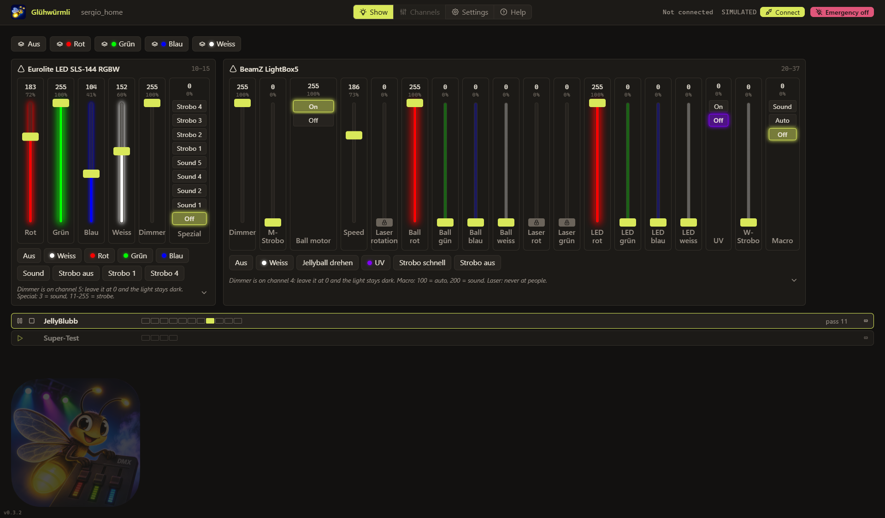

# Glühwürmli

A DMX lighting controller for Windows and macOS, for the living room, the party and the small band. Plug in a USB DMX
interface, set up your devices once, then play them with faders and buttons.

**[Download for Windows](https://github.com/xeronimus/gluehwuermli/releases/latest)** ·
**[Download for macOS](https://github.com/xeronimus/gluehwuermli/releases/latest)** ·
[Website and manual](https://xeronimus.github.io/gluehwuermli/) ·
[Deutsch](https://xeronimus.github.io/gluehwuermli/de/)

## What it does

- **Fixtures and presets:** name your devices and their channels, give a channel a color, and set several channels at
  once with a preset button
- **Scenes:** one button sets the channels of several fixtures at once
- **Chases:** steps of channel values played one after the other, each fading in and held as long as you like,
  started, paused and stopped with a click
- **Show mode and Setup mode:** the app starts in Show mode, where everything can be played and nothing changed; a
  password unlocks Setup mode
- **Channel caps:** a channel, e.g. a laser's, can be capped while the channel lock is on; only the password lifts it
- **English and German**, switched in the Settings view

Projects are `.glp` files, saved on every change; keep them wherever you like and copy them to back up a rig. More
screenshots: [doc/screenshots](doc/screenshots).

## Supported interfaces

Glühwürmli is tested with two USB DMX interfaces, which speak the same protocol:

- **Enttec DMX USB Pro**
- **Eurolite USB-DMX512 PRO**

Any DMX device can be connected to them. Other interfaces aren't supported. Both are tested on Windows; on macOS
they aren't tested yet.

## Kept simple on purpose

Glühwürmli is made to be set up in an evening and played without a manual at hand, so it does less than professional
lighting software:

- Only one DMX universe: 512 channels
- Only the two USB interfaces above; no Art-Net, sACN or other DMX over the network
- No fades yet for faders, presets and scenes: their values change at once; chase steps can fade in
- No fixture library: you enter each device's channels yourself, from its manual
- No 16-bit channels: every channel is 0–255, a device's coarse and fine channel are two separate faders
- No MIDI or other hardware controllers; mouse and keyboard only
- No sound-to-light, beat detection or timecode; a device's own sound mode still works through its channel
- No cue lists, no moving-head effects (pan/tilt shapes), no RDM
- Only one computer and one operator; no remote control from a phone or tablet

## Installing

**Windows:** download the installer (`gluehwuermli-setup-X.Y.Z.exe`) from the
[latest release](https://github.com/xeronimus/gluehwuermli/releases/latest) and run it. The installer isn't signed yet, so Windows SmartScreen may warn about an unknown publisher: choose **More info**,
then **Run anyway**.

Once installed, Glühwürmli updates itself on Windows: on start it looks for a newer release and downloads it in the
background, and installs it when you quit the app. It never asks or restarts while it runs, so a show is never
interrupted.

**macOS** (13 Ventura or newer, Apple Silicon and Intel): download `gluehwuermli-X.Y.Z-mac.dmg` from the
[latest release](https://github.com/xeronimus/gluehwuermli/releases/latest), open it and drag Glühwürmli to
Applications. The app isn't signed by Apple, so macOS refuses to open it the first time: open **System Settings →
Privacy & Security** and choose **Open Anyway** next to the message about Glühwürmli, or run
`xattr -cr "/Applications/Glühwürmli.app"` in Terminal. The Mac app doesn't update itself: download a new version from
the releases page and replace the old one in Applications. Closing its window leaves the app and the DMX output
running, as macOS apps do; quit it with ⌘Q.

The manual is in the app (the Help view) and on the [website](https://xeronimus.github.io/gluehwuermli/#manual).

## Safety

Glühwürmli comes without any warranty (GPL-3.0, see [LICENSE](LICENSE)). It is made for private use, such as a living
room, a party or a small band, not for professional shows or anything safety-critical. The channel lock is not a laser
safety system: it only caps what the app sends. Mount and aim a laser so that it can never hit anyone's eyes, whatever
the app does.

## Contributing

Bug reports and ideas are welcome in the [issues](https://github.com/xeronimus/gluehwuermli/issues). How to build and
run the app from source: [CONTRIBUTING.md](CONTRIBUTING.md).

## License

[GPL-3.0-or-later](LICENSE)
